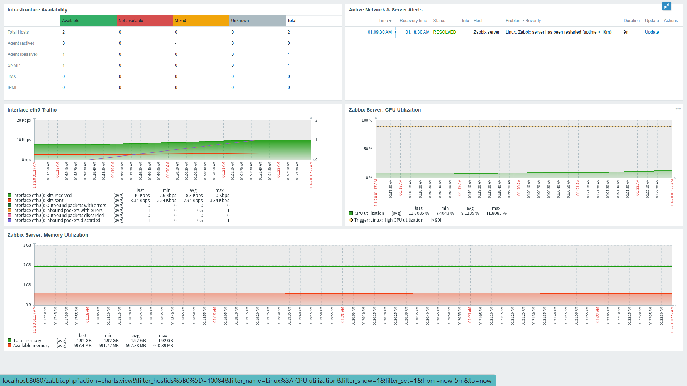
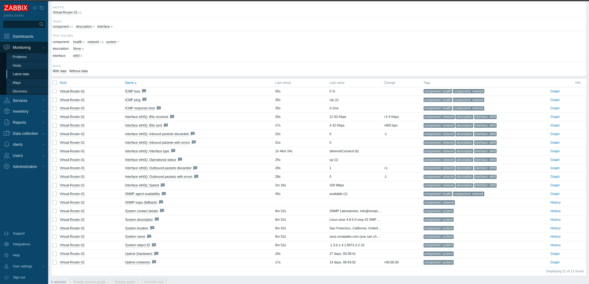
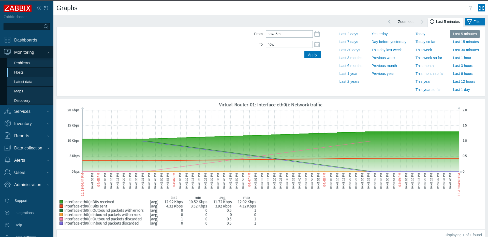
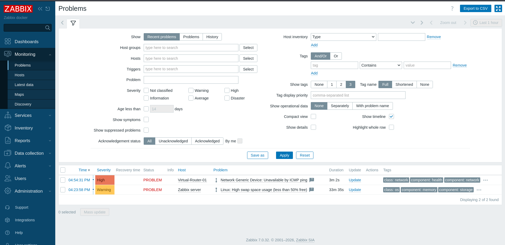
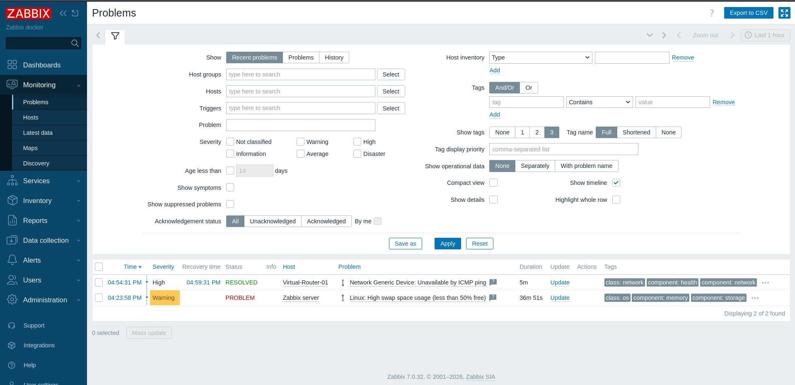

# Network Monitoring & Alerting System with Zabbix & SNMP

A containerized network monitoring and automated fault-detection lab built using **Zabbix 7.0**, **Docker**, and **SNMPv2c**. This project simulates a real-world enterprise monitoring environment where network routers and Linux servers are continuously polled for performance metrics, bandwidth utilization, and availability—complete with automated incident triggering and recovery tracking.

---

## Project Overview

In production networks, administrators need real-time visibility into link utilization, hardware health, and device availability before outages impact users. In this lab, I deployed a full Zabbix 7.0 monitoring stack inside Docker containers on a Kali Linux virtual machine and integrated a simulated network router (`Virtual-Router-01`) via SNMPv2c and ICMP.

To make the monitoring dashboard directly accessible from the Windows host without keeping a VM desktop window open, the guest VM runs in headless mode with VirtualBox NAT port forwarding mapped to `http://localhost:8080`.

### Key Capabilities
* **Real-Time Telemetry:** Polls 21 distinct SNMPv2c and ICMP metrics on `Virtual-Router-01`, tracking `eth0` interface status, link speed (100 Mbps), ingress/egress traffic (`Bits received` / `Bits sent`), packet errors/discards, and system uptime.
* **Custom Monitoring Dashboard:** Centralizes host availability, interface bandwidth graphs, Zabbix server CPU utilization, and active problem alerts on a single screen (`Network performance dashboard`).
* **Fault Detection & Auto-Recovery:** Configured high-severity ICMP/SNMP availability triggers that automatically detect device outages (`PROBLEM`) and clear alerts (`RESOLVED`) once connectivity is restored.
* **Persistent Container Architecture:** Uses a dedicated user-defined Docker bridge network (`172.18.0.0/16`) with static container IP assignments and restart policies so monitoring resumes automatically after VM reboots.

---

## Lab Architecture & Stack

| Component | Technology / Configuration | Role |
| :--- | :--- | :--- |
| **Monitoring Server** | Zabbix Server 7.0.32 (Docker) | Core polling engine, trigger evaluation, and alerting |
| **Web Frontend** | Zabbix Web Nginx + MySQL 8.0 | Web UI exposed on port `8080` and persistent metric storage |
| **Monitored Router** | `Virtual-Router-01` (`tandrup/snmpsim`) | Simulated SNMPv2c network device (`172.18.0.6`, UDP `161`) |
| **Monitored Host** | `Zabbix server` (Zabbix Agent) | Tracks host CPU utilization, swap space, and service health |
| **Virtualization** | Oracle VirtualBox (Kali Linux Guest) | Headless VM execution with NAT Port Forwarding (`Host 8080 -> Guest 8080`) |

---

## Dashboard & Monitoring Walkthrough

### 1. Zabbix Monitoring Dashboard
The primary dashboard aggregates host availability across Zabbix Agent and SNMP interfaces alongside live `eth0` bandwidth graphs, server CPU utilization, and active alerts.



### 2. Real-Time SNMP Telemetry (`Virtual-Router-01`)
Using SNMPv2c polling, Zabbix collects 21 live metrics from `Virtual-Router-01`, including ICMP ping/response time (`0.1ms`), operational interface status (`up`), inbound/outbound bitrates, and system OID details.



### 3. Network Interface Bandwidth Utilization
Historical graphing on `Interface eth0()` visualizes ingress (`12.92 Kbps` max) and egress (`4.32 Kbps` max) throughput alongside inbound/outbound packet error and discard counters.



### 4. Fault Detection & Incident Alerting
To validate alerting workflows, a network outage was simulated on `Virtual-Router-01`. Zabbix immediately detected the unreachable host and fired a **High** severity alert (`Network Generic Device: Unavailable by ICMP ping`).



### 5. Automated Incident Recovery
Once connectivity to `Virtual-Router-01` was restored, Zabbix verified consecutive successful ICMP/SNMP checks and automatically transitioned the incident status from `PROBLEM` to `RESOLVED` (logging a 5-minute outage duration).



---

## Repository Structure

```text
├── screenshots/
│   ├── 01-zabbix-dashboard.png
│   ├── 02-snmp-latest-metrics.png
│   ├── 03-interface-traffic-graph.jpg
│   ├── 04-incident-alert-triggered.png
│   └── 05-incident-auto-resolved.png
└── README.md